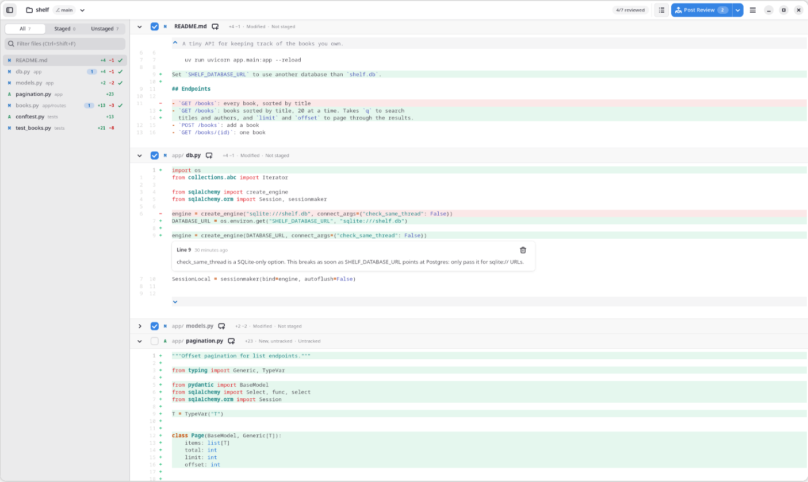

<div align="center">


# Agent Review

**Read what your coding agent changed, leave comments, and hand the feedback back to it.**

[](https://github.com/ralphnajm/agent-review/actions/workflows/ci.yml)
[](https://github.com/ralphnajm/agent-review/releases/latest)
[](LICENSE)

</div>



Coding agents write a lot of code, fast, and interrupting them after every file doesn't
scale. Agent Review is a small native Linux desktop app for reviewing their work *while it
happens*: the diff of every uncommitted change updates live as the agent edits, you leave
comments on lines and files as you read, and when you're ready you hand the agent all your
feedback at once: post it for the agent to pull, or copy it as one tidy Markdown prompt.

It's built with Rust, GTK 4 and libadwaita. No web view, no Electron: the release binary is
about 1 MB and uses the GTK libraries Fedora and Ubuntu already ship.

## How it works

1. Let your agent loose on a Git repository.
2. Open the repository in Agent Review and scroll through the changes as they land.
3. Comment on whatever needs fixing and tick files off as reviewed. Comments pile up
   quietly; nothing is sent until you say so.
4. Press **Post Review** and tell the agent to pull your review. It gets the whole batch in
   one go and marks each comment resolved once it has dealt with it. (No MCP? **Copy
   Feedback** and paste instead.)
5. Repeat until you're happy (or until lunch).

## Features

- **Projects:** open any Git repository (or a sub-folder of one) and switch between recent
  projects at any time.
- **Changes:** every changed file in one scrolling view, like a pull request. Each file's
  header sticks to the top while you scroll through it, and clicking a file in the file panel
  jumps straight to it. Show all uncommitted changes, or only staged or only unstaged ones.
  Untracked files count as new, and everything updates live as the agent edits files.
- **Diffs:** syntax highlighted, with old and new line numbers, find across files, and a
  filter for the file list.
- **Comments:**
  - Click a line number to comment on that line, or drag down the line numbers to comment
    on several lines. Shift-click extends the previous selection.
  - Or select lines in the code and press Ctrl+M.
  - Use the icon next to the file name to comment on the whole file.
  - Comments appear inline, under the lines they refer to.
  - Comments already sent to the agent leave the diff. The clock button next to the file
    name shows how many there are and opens them above the diff for reference.
- **Reviewed checkbox:** tick the box next to the file name to mark the file done. It
  collapses to its header and the view moves on to the next file to review. Commenting on a
  file also marks it reviewed. If the file changes afterwards, it opens again, flagged for
  another look.
- **Post Review:** queues all unsent comments for your agent, which pulls them through the
  [MCP server](#connecting-your-agent). Changed your mind? Undo takes the review back until
  the agent pulls it.
- **Posted reviews:** the list button in the top bar counts the comments your agent hasn't
  resolved yet and lists every review you posted, each comment marked *Waiting*, *Picked up*
  or *Resolved*. It updates live as the agent works.
- **Copy Feedback:** from the arrow next to Post Review, puts all unsent comments on the
  clipboard as a Markdown prompt instead. The toast lets you mark them unsent again.
- **Agent-agnostic:** reviews go through MCP, an open standard most coding agents support,
  or through the clipboard, which works with any agent that accepts text.

Review state lives in `~/.local/share/agent-review/`, never inside your repository.

### Keyboard shortcuts

| Shortcut | Action |
| --- | --- |
| Ctrl+P | Switch project |
| Ctrl+F | Find in files |
| Ctrl+Shift+F | Filter the file list |
| Ctrl+M | Comment on the selected lines |
| Alt+↑ / Alt+↓ | Previous / next file |
| Ctrl+Shift+A | Mark the file as reviewed |
| Ctrl+Shift+P | Post review |
| Ctrl+Shift+C | Copy feedback |
| Ctrl+Shift+R | Posted reviews |

## Installation

Agent Review needs GTK ≥ 4.14, libadwaita ≥ 1.5, GtkSourceView ≥ 5.12 and git. Fedora 40+
and Ubuntu 24.04+ have all of them.

### Packages

Grab the `.deb` or `.rpm` from the
[latest release](https://github.com/ralphnajm/agent-review/releases/latest) and install it:

```sh
sudo apt install ./agent-review_*.deb    # Ubuntu / Debian
sudo dnf install ./agent-review-*.rpm    # Fedora
```

### From source

With the [build dependencies](#building) installed:

```sh
make install PREFIX=~/.local    # just for you; "Agent Review" then shows up in app search
sudo make install               # system-wide, into /usr/local
```

To build a package yourself:

```sh
cargo install cargo-generate-rpm && make rpm   # target/generate-rpm/*.rpm
cargo install cargo-deb && make deb            # target/debian/*.deb
```

## Usage

Launch *Agent Review* from your app launcher, or open a project straight from a terminal:

```sh
agent-review path/to/repo
```

### Connecting your agent

Your agent pulls posted reviews through Agent Review's MCP server, `agent-review --mcp`.
Add it to your agent once; the agent starts it by itself when needed, and it works whether
or not the app is open. For example:

```sh
# Claude Code
claude mcp add --scope user agent-review -- agent-review --mcp
```

```toml
# Codex: ~/.codex/config.toml
[mcp_servers.agent-review]
command = "agent-review"
args = ["--mcp"]
```

Agents configured with an `mcpServers` JSON file, such as Gemini CLI and Cursor:

```json
{ "mcpServers": { "agent-review": { "command": "agent-review", "args": ["--mcp"] } } }
```

Then post a review and ask the agent to "pull my review". The server gives the agent two
tools: `get_review` returns the open comments for the repository it is working in, and
`resolve_comments` marks the ones it has addressed, which you see in *Posted reviews*.

## Development

### Building

Rust comes from [rustup](https://rustup.rs); `rust-toolchain.toml` pins the latest stable
release, so local builds and CI use the same compiler. Other build dependencies:

```sh
# Fedora
sudo dnf install rustup gtk4-devel libadwaita-devel gtksourceview5-devel desktop-file-utils appstream
# Ubuntu
sudo apt install libgtk-4-dev libadwaita-1-dev libgtksourceview-5-dev desktop-file-utils appstream
```

| Command | What it does |
| --- | --- |
| `make run` (or `cargo run -- <repo>`) | Run a debug build |
| `make check` | rustfmt check, clippy (pedantic, warnings as errors), tests, and desktop/AppStream validation |
| `make fmt` | Format the code |
| `make release` | Optimised build (thin LTO, stripped) |

`scripts/demo-repo.sh` creates a small demo project with an agent's uncommitted work in
`target/demo/shelf`, for trying things out and taking screenshots.

CI (`.github/workflows/ci.yml`) runs `make check` on Ubuntu 24.04 and builds the `.deb` and
`.rpm` packages for every push and pull request.

### Project layout

```
src/
  core/         UI-independent logic, unit tested
    git.rs        repository access through the git CLI (status, diffs, watched dirs)
    status.rs     `git status --porcelain=v2` parser
    diff.rs       unified diff parser, fingerprints, line snippets
    review.rs     comments, line-range anchors and reviewed state
    feedback.rs   Markdown prompt generation
    queue.rs      posted reviews and the agent's progress on them
    mcp.rs        MCP server (`agent-review --mcp`) agents pull reviews from
    watcher.rs    inotify watchers for the repository and the review queue
    store.rs      settings and review persistence (XDG directories)
  ui/           GTK widgets
    window.rs     main window, actions and state
    diff_view.rs  GtkSourceView diff with inline comment threads
    reviews_dialog.rs  posted reviews and their status
    file_list.rs, project_switcher.rs
data/           desktop entry, AppStream metadata, icons
```

### Releasing

Describe every user-facing change in `CHANGELOG.md` under `## [Unreleased]` as you make it.
To release:

1. Bump `version` in `Cargo.toml` following [Semantic Versioning](https://semver.org/): patch
   for fixes, minor for new features, major for breaking changes. Run `cargo build` so
   `Cargo.lock` picks up the new version.
2. Rename `## [Unreleased]` in `CHANGELOG.md` to `## [x.y.z] - YYYY-MM-DD`.
3. Add a matching `<release version="x.y.z" date="YYYY-MM-DD"/>` entry at the top of
   `<releases>` in `data/io.github.ralphnajm.AgentReview.metainfo.xml`.
4. Run `make check` (it fails if the changelog or metadata entry is missing), commit and push.

When the build succeeds, CI creates the `vx.y.z` tag and a GitHub release with the packages
attached and the changelog section as its notes. Pushing without a version bump only runs
the checks, because that version already has a release.

## Contributing

Bug reports, ideas and pull requests are welcome. Please run `make check` before opening a
pull request, and add a line to `CHANGELOG.md` if users will notice the change.

## Who built this?

Agent Review is written by [Claude](https://claude.com/claude-code), and designed, reviewed
and managed by humans. Yes, an app for reviewing what coding agents write was itself written
by a coding agent. The humans decide what gets built, read the diffs and leave the
comments; Claude writes the code and gets the feedback. That's exactly the loop the app is
for, so it gets a lot of dogfooding.

## License

[MIT](LICENSE)
